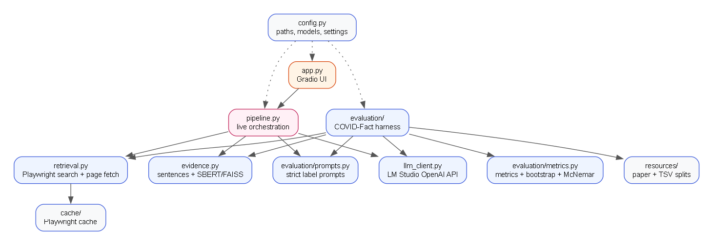
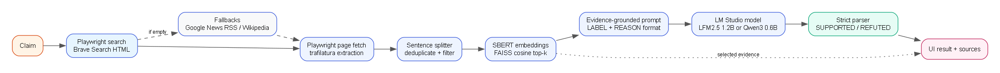
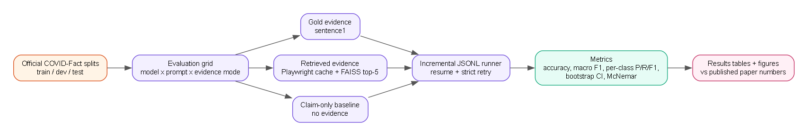

# Architecture

## System overview

The project has three execution paths that share the same retrieval, evidence-ranking, and LLM code:

1. **Local live path** (`app.py` or `docs/` → `api.py` → `pipeline.py`): a user enters a social-media claim, Playwright searches the web, evidence is ranked, and one selected LM Studio model returns an answer-first `SUPPORTED`, `REFUTED`, or `UNVERIFIED` verdict. Deterministic verification can override the model.
2. **Hosted website path** (`docs/` → `api.py` → `pipeline.py`): the static Factly frontend calls the FastAPI backend through a Cloudflare Quick Tunnel using a shared access code.
3. **Evaluation path** (`evaluation/`): the official COVID-Fact TSV splits are used with gold evidence, retrieved evidence, or a claim-only baseline, and results are written to JSONL and metrics tables. Evaluation remains binary.

`config.py` is the single source of truth for paths, model ids, retrieval settings, thresholds, and label mappings.

## Module map

| Module | Responsibility |
|---|---|
| `config.py` | Environment loading, paths, model ids, retrieval settings, thresholds, live/dataset labels |
| `llm_client.py` | LM Studio OpenAI-compatible client, health check, live answer parser, strict dataset parser |
| `verification.py` | Publication-date extraction, entity/term coverage, source and citation gates, abstention |
| `model_manager.py` | `lms` discovery, loaded-model inspection, one-model-at-a-time switching |
| `retrieval.py` | Playwright search and page fetch, Brave primary provider, fallbacks, publication dates, on-disk cache |
| `evidence.py` | Sentence splitting, deduplication, SBERT embeddings, FAISS cosine ranking |
| `pipeline.py` | Live orchestration, candidate selection, verification integration, research comparison path |
| `app.py` | Optional Gradio UI for live checks, pipeline diagram, evaluation summary, label policy |
| `api.py` | FastAPI wrapper for the hosted frontend: auth, CORS, rate limits, model control, serialization |
| `docs/index.html`, `docs/app.js`, `docs/styles.css` | Factly static frontend and Gemini-inspired original design |
| `scripts/` | PowerShell launchers for the API, static frontend, and Cloudflare tunnel |
| `evaluation/prompts.py` | Zero-shot, few-shot, claim-only, and UI prompts |
| `evaluation/evaluate_covidfact.py` | COVID-Fact runner, gold/retrieved/claim-only modes, incremental JSONL |
| `evaluation/build_retrieval_cache.py` | Reproducible Playwright retrieval cache builder |
| `evaluation/metrics.py` | Accuracy, macro/weighted F1, per-class P/R/F1, bootstrap CI, McNemar |
| `docs/generate_diagrams.py` | Generates the Graphviz diagrams in this folder |

## Live request flow

1. The UI or API validates the claim and selected model.
2. `model_manager.ensure_only_model` unloads the current model first if a different one is selected, so only one model is resident at a time.
3. `pipeline.check_claim` calls `retrieval.search_and_fetch`:
   - searches Brave Search's HTML result page with Playwright;
   - falls back to Google News RSS and Wikipedia if Brave returns nothing;
   - fetches up to `RETRIEVAL_MAX_PAGES` pages with Playwright;
   - extracts readable text with `trafilatura`, then BeautifulSoup as a fallback;
   - records publication dates from result metadata and page metadata when available.
4. `evidence.build_candidates` flattens page sentences and search snippets.
5. `evidence.rank_sentences` embeds the claim and candidates with `all-MiniLM-L6-v2`, normalizes them, and uses `faiss.IndexFlatIP` for cosine ranking. Up to 20 candidates are kept; the top five are used in the prompt.
6. `pipeline._classify` builds the live prompt and calls the selected LM Studio model. The model returns a label, confidence, answer, reason, and citations.
7. `llm_client.parse_live_response` accepts `SUPPORTED`, `REFUTED`, or `UNVERIFIED`; invalid answers get one correction retry.
8. `verification.analyze` measures relevance, source diversity, claim/evidence dates, missing terms, and plan-only evidence.
9. `verification.apply_guard` downgrades unsupported or uncited verdicts to `UNVERIFIED`. Date support requires an evidence item that both matches the claim date and covers all key terms.
10. The frontend displays the answer first, then confidence/reason/citations, the five passages used, the wider retrieved candidate set, and run metadata.

If no usable evidence is retrieved, the live path returns **UNVERIFIED** rather than guessing. `UNVERIFIED` is a live label, not part of the binary COVID-Fact evaluation.

## Evaluation flow

The evaluator supports three evidence modes:

| Mode | Evidence shown to the model |
|---|---|
| `gold` | The dataset's `sentence1` premise |
| `retrieved` | Top-k sentences from the Playwright cache |
| `claim_only` | No evidence; a separate claim-only prompt |

Prompt variants are `zero_shot` and `few_shot`. Few-shot examples are drawn deterministically from `train.tsv` only; the test split is never used to construct prompts. Results are appended to JSONL after every example so interrupted runs can resume.

## Label policy

The live UI uses three labels:

| Live label | Meaning |
|---|---|
| `SUPPORTED` | Retrieved evidence is sufficient and confirms the claim's key details |
| `REFUTED` | Retrieved evidence contradicts the claim's key details |
| `UNVERIFIED` | Evidence is missing, weak, mismatched, or does not confirm the claim |

The official benchmark data uses `entailment` / `not_entailment`. Evaluation maps them to:

| Dataset value | Evaluation label |
|---|---|
| `entailment` | `SUPPORTED` |
| `not_entailment` | `REFUTED` |

Evaluation remains binary and never emits `UNVERIFIED`; the dataset parser rejects it. Neither path emits `True`, `False`, or `Misleading`.

## Why Brave and Playwright

The earlier hosted search API was removed because the project needed a no-API-key, demonstrable retrieval layer that runs locally. Playwright provides the browser automation. During testing, Bing returned poisoned results to headless automation and DuckDuckGo's HTML endpoint was unavailable; Brave Search HTML returned relevant results reliably, so it is the primary provider.

## Operational notes

- LM Studio must be running at `http://localhost:1234`.
- Only one model is kept loaded. Switching models unloads the previous model first through `lms unload --all` and `lms load`.
- `reasoning_effort=none` is sent by default because Qwen3 otherwise spends the whole completion budget on hidden reasoning tokens and returns empty content.
- The first request to an unloaded model is slower (JIT load); later requests are warm.
- Retrieval caches live under `cache/retrieval/` and are intentionally git-ignored.
- The curated evaluation cache lives under `evaluation/retrieval_cache/` and can be committed because it is the reproducible evidence snapshot used by the report.
