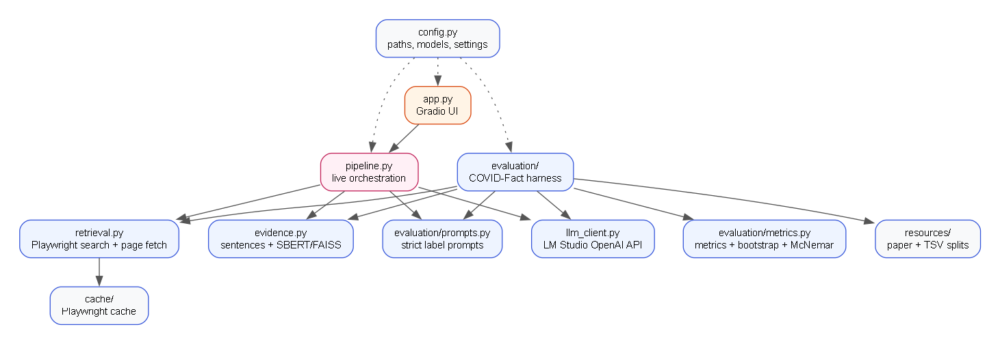
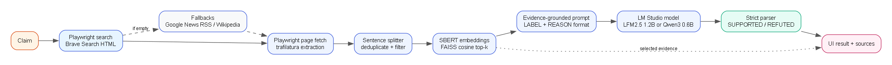
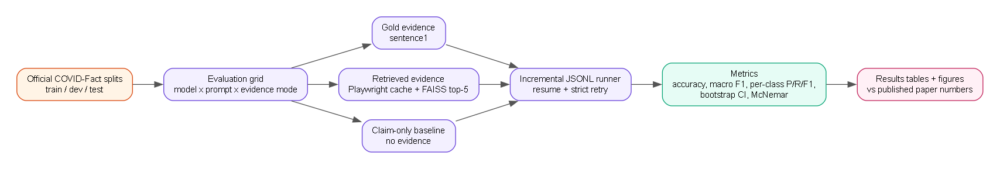

# Retrieval-Grounded Fact Checking with Small Local Language Models on COVID-Fact

**Project report draft**

Department of Computer Science and Engineering, RCC Institute of Information Technology

Faculty supervisor: Dr. Anup Kumar Kolya

## Abstract

This project builds a retrieval-augmented fact-checking system for social-media claims and evaluates its retrieval and classification pipeline against the COVID-Fact benchmark. The system replaces a hosted search API with local Playwright-based web retrieval, extracts and ranks evidence sentences using SBERT and FAISS, and asks a small quantized model running in LM Studio for an answer-first verdict: `SUPPORTED`, `REFUTED`, or `UNVERIFIED`. Deterministic checks on publication dates, key terms, source diversity, and citations can downgrade an unsupported model verdict. Only one model is loaded at a time, and both supported models remain selectable. A full 401-example test evaluation is reported for gold evidence with two models and two prompt variants, together with a 60-example stratified retrieval sample. The best configuration, LFM2.5 1.2B with three few-shot examples, reaches 64.3% accuracy and 0.630 macro F1 with gold evidence. This is well below the COVID-Fact paper's fine-tuned RoBERTa-large (83.5% / 82.0) but has higher macro F1 than the paper's claim-only baseline (40.0), showing that the small model is less majority-class-biased while remaining substantially less accurate. The COVID-Fact numbers are a labelled reference benchmark, not a social-media benchmark. The project also delivers a working web application, a reproducible evaluation harness, cached retrieval snapshots, diagrams, and a documented path to a hosted frontend with a laptop-backed API.

## 1. Introduction

Social-media claims spread quickly and are often near-misses: a real event is cited with a changed entity, number, date, or relation. A fact checker must retrieve relevant evidence, identify the specific detail that changed, and avoid presenting weak evidence as confirmation. Large hosted language models can do this well but are expensive, opaque, and dependent on external APIs. This project asks whether small local models, grounded in retrieved evidence and constrained by deterministic checks, can provide a useful baseline.

The project has four goals:

1. Build a live, evidence-first checker for general social-media claims with `SUPPORTED`, `REFUTED`, and `UNVERIFIED` outcomes.
2. Reproduce the binary COVID-Fact task with the official data and labels as a reference benchmark.
3. Evaluate two small LM Studio models under controlled gold, retrieved, and claim-only conditions.
4. Deliver a usable interface, one-model-at-a-time operation on an 8 GB laptop, and a reproducible evaluation/reporting workflow.

## 2. The COVID-Fact benchmark

COVID-Fact (Saakyan et al., ACL 2021) contains real-world COVID-19 claims paired with evidence sentences and binary support/refute labels. The official RTE-format splits used here are:

| Split | Rows | SUPPORTED | REFUTED |
|---|---:|---:|---:|
| train | 3,263 | 1,036 | 2,227 |
| dev | 419 | 130 | 289 |
| test | 401 | 130 | 271 |

The paper reports RoBERTa-large results with gold evidence: **83.5% accuracy / 82.0 F1**. With top-5 retrieved evidence it reports **84.7% / 83.0**. A claim-only classifier reaches **67.5% / 40.0**, and COVID-FEVER transfer reaches **43.3%**. Top-5 retrieval is reported as **P 22.27 / R 52.37 / F1 31.25**.

The paper's label names are `SUPPORTED` and `REFUTED`. This project uses exactly those names. The official TSV files use `entailment` and `not_entailment`; the mapping is fixed in `config.py`.

## 3. System design

### 3.1 Live pipeline

1. The user enters a claim in the web UI, Gradio UI, or API.
2. `model_manager.ensure_only_model` unloads the current model if the user selected a different one.
3. Playwright searches Brave Search and, if necessary, Google News RSS or Wikipedia.
4. Up to two or three pages are fetched, with images, media, fonts, and stylesheets blocked for speed.
5. `trafilatura` extracts readable text and publication metadata; BeautifulSoup is the fallback.
6. Page text is split into deduplicated sentences. Search snippets are used when page extraction fails.
7. Sentence-BERT (`all-MiniLM-L6-v2`) embeds the claim and candidates; FAISS cosine similarity ranks up to 20 candidates, and the top five are used in the prompt.
8. The selected passages are formatted as numbered, date-aware evidence blocks.
9. One selected LM Studio model returns a label, confidence, direct answer, reason, and citations.
10. `verification.analyze` and `verification.apply_guard` check dates, key terms, source diversity, plan-only evidence, and citation validity; unsupported verdicts are downgraded to `UNVERIFIED`.
11. The UI shows the answer first, then confidence, reason, citations, the five passages used, the wider candidate set, and run metadata.
12. If no usable evidence is retrieved, the UI returns **UNVERIFIED** instead of guessing.

### 3.2 Models

| Role | Model | Quantization | Context |
|---|---|---|---|
| Primary | `liquid/lfm2.5-1.2b` | Q4_K_M | 128k |
| Alternate | `qwen3-0.6b` | Q3_K_L | 32k |

Only one model is resident at a time on the 8 GB demo laptop. Models are served by LM Studio's OpenAI-compatible endpoint at `http://localhost:1234/v1/chat/completions`. Requests send `reasoning_effort=none`; without it, Qwen3 spends its entire completion budget on hidden reasoning tokens and returns empty content.

### 3.3 Live and evaluation parsers

The live parser accepts `SUPPORTED`, `REFUTED`, or `UNVERIFIED`, including prefixed forms such as `LABEL: SUPPORTED`, and extracts confidence, answer, reason, and citations. Invalid answers receive one correction retry. The evaluation parser is deliberately stricter: it accepts only `SUPPORTED` and `REFUTED`, and it rejects `UNVERIFIED`, `True`, `False`, `Misleading`, empty output, and ambiguous responses containing both binary labels. Persisting invalid evaluation answers are recorded separately and excluded from metric denominators.

### 3.4 Evaluation harness

The harness supports:

- `gold` evidence: the dataset premise;
- `retrieved` evidence: a cached Playwright retrieval snapshot;
- `claim_only`: no evidence, using a separate prompt.

Prompt variants are zero-shot and three-shot. Few-shot examples come only from the training split, selected deterministically with seed 42. Raw predictions are appended to JSONL after every example, so runs resume after interruption. Metrics include accuracy, macro/weighted F1, per-class P/R/F1, confusion matrices, bootstrap confidence intervals, and an exact McNemar test.

## 4. Experiments

### 4.1 Gold-evidence experiment

Both models were evaluated on all 401 test examples with zero-shot and few-shot prompts. The same evidence, `sentence1`, was shown to both models. Temperature was 0 and maximum output was 12 tokens. The gold setting isolates classification and instruction-following from retrieval quality.

### 4.2 Retrieval sample

A full 401-claim Playwright page-fetch run is expensive on a laptop. The fast path uses a deterministic, class-stratified sample of 60 test claims (19 SUPPORTED / 41 REFUTED, seed 42) and a cache with up to two fetched pages per claim. The sample is reported as a sample, not as a full replacement for the paper's retrieval experiment. The cache build resolved 8 claims with Brave page text, 47 through Google News RSS snippets, and 5 with no usable result, so the retrieval run is mostly snippet-based.

### 4.3 Dev check

The full dev split was run for LFM2.5 with both prompts. The Qwen dev run was stopped early to keep the fast path short; Qwen prompt behavior was checked on a 20-example dev subset and the full test split is reported for transparency.

## 5. Results

### 5.1 Gold evidence, full test split

| Model | Prompt | N | Accuracy | Macro F1 | Weighted F1 | Invalid | 95% CI |
|---|---|---:|---:|---:|---:|---:|---|
| LFM2.5 1.2B | few-shot | 401 | 64.3% | 0.6301 | 0.6548 | 0 | [59.6%, 68.8%] |
| Qwen3 0.6B | zero-shot | 401 | 54.6% | 0.5413 | 0.5578 | 0 | [50.1%, 59.4%] |
| LFM2.5 1.2B | zero-shot | 401 | 34.7% | 0.2812 | 0.2049 | 0 | [29.9%, 39.4%] |
| Qwen3 0.6B | few-shot | 401 | 33.9% | 0.2765 | 0.2016 | 0 | [29.4%, 38.7%] |

### 5.2 Confusion matrices

Rows are gold, columns are predicted, order `SUPPORTED`, `REFUTED`.

| Model | Prompt | Matrix |
|---|---|---|
| LFM2.5 1.2B | few-shot | `[[91, 39], [104, 167]]` |
| Qwen3 0.6B | zero-shot | `[[89, 41], [141, 130]]` |
| LFM2.5 1.2B | zero-shot | `[[130, 0], [262, 9]]` |
| Qwen3 0.6B | few-shot | `[[127, 3], [262, 9]]` |

LFM zero-shot and Qwen few-shot collapse to SUPPORTED (390/401 and 389/401). LFM few-shot and Qwen zero-shot produce a usable balance.

### 5.3 Paired comparison

LFM2.5 few-shot beat Qwen3 zero-shot on 92 examples, lost on 53, and tied on the rest. The exact McNemar p-value is **0.0015**, so the difference is significant at the 0.05 level for this test split.

### 5.4 Dev results

| Model | Prompt | N | Accuracy | Macro F1 |
|---|---|---:|---:|---:|
| LFM2.5 1.2B | few-shot | 419 | 59.4% | 0.5836 |
| LFM2.5 1.2B | zero-shot | 419 | 33.7% | 0.2783 |

The dev ranking agrees with the test ranking for LFM.

### 5.5 Retrieved evidence sample

The 60-claim retrieval sample produced 5 no-evidence cases per configuration. Gold and retrieved numbers are not directly comparable because the retrieved sample is smaller, class-stratified, and mostly uses search snippets rather than fetched page sentences.

| Model | Prompt | N | Accuracy | Macro F1 | Weighted F1 | Invalid | 95% CI |
|---|---|---:|---:|---:|---:|---:|---|
| LFM2.5 1.2B | few-shot | 60 | 71.7% | 0.6679 | 0.7145 | 0 | [60.0%, 83.3%] |
| Qwen3 0.6B | zero-shot | 60 | 58.3% | 0.5823 | 0.5899 | 0 | [45.0%, 71.7%] |

| Model | Class | Precision | Recall | F1 | Support |
|---|---|---:|---:|---:|---:|
| LFM2.5 1.2B | SUPPORTED | 0.5556 | 0.5263 | 0.5405 | 19 |
| LFM2.5 1.2B | REFUTED | 0.7857 | 0.8049 | 0.7952 | 41 |
| Qwen3 0.6B | SUPPORTED | 0.4211 | 0.8421 | 0.5614 | 19 |
| Qwen3 0.6B | REFUTED | 0.8636 | 0.4634 | 0.6032 | 41 |

The end-to-end path (Playwright search → extraction → SBERT/FAISS ranking → LM Studio) completed without runtime errors on all 60 claims. The result supports the LFM2.5 few-shot configuration used in the application, but it should be read as a pilot retrieval result, not a full benchmark.

### 5.6 Comparison with the paper

| System | Accuracy | F1 |
|---|---:|---:|
| RoBERTa-large, gold | 83.5% | 82.0 |
| RoBERTa-large, top-5 retrieved | 84.7% | 83.0 |
| Claim-only classifier | 67.5% | 40.0 |
| COVID-FEVER transfer | 43.3% | - |
| LFM2.5 1.2B few-shot, gold | 64.3% | 63.0 macro |
| Qwen3 0.6B zero-shot, gold | 54.6% | 54.1 macro |
| LFM2.5 1.2B few-shot, 60-claim retrieved sample | 71.7% | 66.8 macro |
| Qwen3 0.6B zero-shot, 60-claim retrieved sample | 58.3% | 58.2 macro |

The small local models are far below the paper's fine-tuned RoBERTa. LFM few-shot is below the paper's claim-only accuracy but far above its reported claim-only F1; the latter is a single F1 value, so the comparison is indicative rather than a formal head-to-head.

## 6. Discussion

The main finding is that evidence grounding and a strict prompt are not enough to close the gap to a fine-tuned model. The two best configurations differ sharply: LFM responds well to few-shot examples, while Qwen is hurt by the same examples. This is a prompt-sensitivity problem, not a property of the dataset. The majority-class collapse in the other two configurations shows why accuracy alone is misleading on this imbalanced split; macro F1 and per-class recall are essential.

The retrieval layer is deliberately local and inspectable. Brave Search through Playwright worked where Bing and DuckDuckGo did not, and the cache makes evaluation reproducible. The main retrieval risk is page extraction quality: paywalls, JavaScript-heavy pages, and changing search results can starve the model of evidence. Snippet fallback helps but is not equivalent to full-page retrieval.

The live extension adds a deterministic verification layer on top of the model. In a representative failure, LFM returned `SUPPORTED HIGH` for a date-specific claim while citing sources that did not connect the claim's key terms to the claimed date. The guard downgraded the result to `UNVERIFIED LOW` because no single evidence item both matched the date and covered all key terms. This is the central design lesson: the model's prose can look confident while its evidence does not actually support the claim.

## 7. Limitations

- Only two small quantized models were tested.
- The full test split was used for the final comparison; LFM prompt selection used dev, while Qwen prompt selection used a small dev subset and the full test split is reported for transparency.
- The retrieval evaluation is a 60-example sample, not a full 401-claim retrieval benchmark.
- COVID-Fact is the only labelled benchmark; live social-media performance is qualitative and the demo has not been evaluated on a social-media dataset.
- The date and entity guards are conservative. They can downgrade a true claim when sources omit a matching date or use synonyms rather than the claim's exact terms.
- Live retrieval is time-sensitive and search-engine behavior changes.
- No human evaluation of reasons or citation faithfulness was performed.
- The claim-only baseline prompt and the paper's claim-only classifier are not identical systems.

## 8. Future work

The hosted frontend, FastAPI backend, model-selection endpoint, access-code gate, rate limits, and Cloudflare Tunnel workflow are implemented. The next evaluation step is to create a small labelled social-media claim set and measure end-to-end verdict quality, citation faithfulness, and abstention behaviour.

Other extensions include full retrieval evaluation, prompt ensembling, calibrated confidence, broader date and entity normalization, multilingual claims, and a WhatsApp/Telegram bot.

## 9. Conclusion

The project delivers a working evidence-first fact-checking application, a reproducible COVID-Fact evaluation harness, cached retrieval evidence, diagrams, and a documented deployment path. The live interface generalizes beyond COVID-19, exposes the five passages used for each verdict, returns `UNVERIFIED` when evidence is insufficient, and enforces one loaded model at a time on an 8 GB laptop. The best small-model configuration reaches 64.3% accuracy / 0.630 macro F1 with gold evidence on COVID-Fact, which is a useful local baseline but far from the paper's fine-tuned RoBERTa. The results also show that prompt choice can change small-model behaviour more than model size, and that class-balanced metrics are necessary on this dataset.

## References

1. Arkadiy Saakyan, Tuhin Chakrabarty, and Smaranda Muresan. 2021. COVID-Fact: Fact Extraction and Verification of Real-World Claims on COVID-19 Pandemic. ACL-IJCNLP 2021, pages 2116–2129. https://aclanthology.org/2021.acl-long.165/
2. Nils Reimers and Iryna Gurevych. 2019. Sentence-BERT: Sentence Embeddings using Siamese BERT-Networks. EMNLP-IJCNLP 2019.
3. Jeff Johnson, Matthijs Douze, and Hervé Jégou. 2019. Billion-scale similarity search with GPUs. IEEE Transactions on Big Data.
4. LM Studio documentation: https://lmstudio.ai/docs
5. Playwright for Python documentation: https://playwright.dev/python/
6. Trafilatura documentation: https://trafilatura.readthedocs.io/
